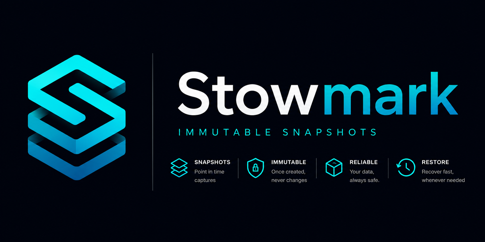

<p align="center">
  
</p>

[](https://github.com/bruli-lab/stowmark/actions/workflows/release.yml)
[](https://codecov.io/gh/bruli-lab/stowmark)
[](https://github.com/bruli-lab/stowmark/releases/latest)
[](https://github.com/bruli-lab/stowmark/releases)
[](https://github.com/bruli-lab/stowmark/blob/main/LICENSE)
[](https://github.com/bruli-lab/stowmark/blob/main/go.mod)

[Website](https://stowmark.dev) ·
[Releases](https://github.com/bruli-lab/stowmark/releases) ·
[Issues](https://github.com/bruli-lab/stowmark/issues)

---

Stowmark is a lightweight backup tool that stores directory snapshots in a local, SSH-hosted, SMB-hosted,
S3-compatible, Google Cloud Storage or WebDAV-hosted immutable-style repository.

Files are identified by their SHA-256 hash and stored only once. Each snapshot is represented by a manifest containing
the source path, creation time and references to its files.

> **Note**
>
> Stowmark is under active development. The repository format and command-line
> interface may change before the first stable release.

## Features

- Content-addressed object storage using SHA-256.
- Deduplication of unchanged files between snapshots.
- Automatic chunking for files larger than 8 MiB.
- Exclusion of files and directories with a `.stowmarkignore` file or `--exclude` patterns.
- Optional `gzip`, `zstd`, `lz4` and `xz` compression.
- Optional client-side encryption using AES-256-GCM and RSA-OAEP-SHA256.
- Encryption key rotation without exposing plaintext data to remote storage.
- Separate JSON manifest for every snapshot.
- Snapshot listing ordered from newest to oldest.
- Inspection of a snapshot and all its files.
- Integrity verification using SHA-256 hashes.
- Retention policies (`forget`) and garbage collection of unreferenced objects (`prune`).
- Whole repository integrity checks (`check`), optionally reading all or part of the data.
- JSON output (`--json`) for scripting.
- Local repositories with no external service required.
- Remote repositories over SSH/SFTP using public-key authentication.
- Remote repositories over SMB using password authentication.
- Remote repositories in Amazon S3 and S3-compatible object storage.
- Optional WORM retention of every object, manifest and the repository config, with S3 Object Lock or GCS object
  retention.
- Remote repositories in Google Cloud Storage using Application Default Credentials.
- Remote repositories over WebDAV using username and password authentication.
- Optional OpenTelemetry observability through an OTLP-compatible collector.
- Linux and Windows builds for `amd64` and `arm64`.
- Debian packages generated with GoReleaser.
- Windows installer for `amd64`.

## Installation

### Debian package

Download the package for your architecture from the
[latest GitHub release](https://github.com/bruli-lab/stowmark/releases/latest)
and install it with:

```bash
sudo dpkg -i stowmark_*.deb
```

### Windows

Download the `amd64` installer from the
[latest GitHub release](https://github.com/bruli-lab/stowmark/releases/latest),
run it and open a new PowerShell window:

```powershell
stowmark --help
```

Portable ZIP files are also available for `amd64` and `arm64`. Extract the ZIP
and run `stowmark.exe` directly:

```powershell
.\stowmark.exe --help
```

### Verify a release

Every release publishes a `checksums.txt` with the SHA-256 of each archive, package and SBOM, signed with
[Sigstore cosign](https://docs.sigstore.dev/) by the release workflow (keyless, no long-lived key). Download
`checksums.txt`, `checksums.txt.sigstore.json` and the files you want into the same directory, check the signature
and then the files:

```bash
cosign verify-blob \
  --certificate-identity 'https://github.com/bruli-lab/stowmark/.github/workflows/release.yml@refs/heads/main' \
  --certificate-oidc-issuer 'https://token.actions.githubusercontent.com' \
  --bundle checksums.txt.sigstore.json \
  checksums.txt

sha256sum --check --ignore-missing checksums.txt
```

The Windows installer is built in a separate job and has its own signature,
`stowmark_<version>_windows_amd64_setup.exe.sigstore.json`:

```bash
cosign verify-blob \
  --certificate-identity 'https://github.com/bruli-lab/stowmark/.github/workflows/release.yml@refs/heads/main' \
  --certificate-oidc-issuer 'https://token.actions.githubusercontent.com' \
  --bundle stowmark_<version>_windows_amd64_setup.exe.sigstore.json \
  stowmark_<version>_windows_amd64_setup.exe
```

Each archive and Debian package also has an SPDX SBOM (`<file>.sbom.json`) listing the Go modules it was built with.

### Build from source

Requirements:

- Go 1.27.4 or newer (see `go.mod`).
- Git.

```bash
git clone https://github.com/bruli-lab/stowmark
cd stowmark

go build -o stowmark ./cmd/cli
sudo install -m 0755 stowmark /usr/local/bin/stowmark
```

Check the installation:

```bash
stowmark --help
```

## Quick start

Create a new Stowmark repository:

```bash
stowmark init --repo /srv/backups/stowmark
```

Create a repository using compression:

```bash
stowmark init --repo /srv/backups/stowmark \
  --compression zstd \
  --level 3
```

Create a snapshot of a directory:

```bash
stowmark snapshot create ~/documents \
  --repo /srv/backups/stowmark
```

List the available snapshots:

```bash
stowmark snapshot list \
  --repo /srv/backups/stowmark
```

Inspect a snapshot manifest:

```bash
stowmark snapshot get \
  --id <snapshot-id> \
  --repo /srv/backups/stowmark
```

Verify that every object referenced by a snapshot is present and unmodified:

```bash
stowmark snapshot verify \
  --id <snapshot-id> \
  --repo /srv/backups/stowmark
```

Restore a snapshot. Without `--destination`, files are restored to their original paths, inside the source directory
of the snapshot:

```bash
stowmark snapshot restore \
  --id <snapshot-id> \
  --repo /srv/backups/stowmark \
  --destination /srv/backups/stowmark-restore
```

Restore a file from snapshot:

```bash
stowmark snapshot restore \
  --id <snapshot-id> \
  --file <path> \
  --repo /srv/backups/stowmark \
  --destination /srv/backups/stowmark-restore
```

## SSH repositories

Stowmark can store a repository on a remote server over SSH. The source directory and restored files remain on the
local machine; repository configuration, objects and snapshot manifests are read and written remotely over SFTP.

Set the private key used to authenticate with the SSH server:

```bash
export STOWMARK_SSH_PRIVATE_KEY="$HOME/.ssh/id_ed25519"
```

If the key is protected with a passphrase, also set `STOWMARK_SSH_PRIVATE_KEY_PASSPHRASE`. Environment variables can be
read by other processes of the same user, so prefer an `ssh-agent` for protected keys: when
`STOWMARK_SSH_PRIVATE_KEY` is not set, Stowmark authenticates with the keys of the agent in `SSH_AUTH_SOCK`.

```bash
eval "$(ssh-agent)"
ssh-add ~/.ssh/id_ed25519
```

When `STOWMARK_SSH_PRIVATE_KEY` is set, only that key is used, even if an agent is running.

The host key of the server is checked against `~/.ssh/known_hosts`, and a host that is not there or whose key changed
is rejected. Set `STOWMARK_SSH_KNOWN_HOSTS` to use another file, for example one dedicated to the backup servers:

```bash
export STOWMARK_SSH_KNOWN_HOSTS="/etc/stowmark/known_hosts"
```

Use an SSH repository URL anywhere that `--repo` or the repository argument is accepted:

```text
ssh://<user>@<host>[:<port>]/<absolute-path>
```

Initialize a remote repository:

```bash
stowmark init --repo ssh://backup@example.com/srv/backups/stowmark
```

Create and list snapshots:

```bash
stowmark snapshot create ~/documents \
  --repo ssh://backup@example.com/srv/backups/stowmark

stowmark snapshot list \
  --repo ssh://backup@example.com/srv/backups/stowmark
```

Verify and restore a remote snapshot:

```bash
stowmark snapshot verify \
  --id <snapshot-id> \
  --repo ssh://backup@example.com/srv/backups/stowmark

stowmark snapshot restore \
  --id <snapshot-id> \
  --repo ssh://backup@example.com/srv/backups/stowmark
```

The SSH user must have permission to create and modify the repository directory. The SSH server must provide the SFTP
subsystem. Password authentication is not used.

## SMB repositories

Stowmark can store a repository on an SMB share. The source directory and restored files remain on the local machine;
repository configuration, objects and snapshot manifests are read and written remotely over SMB.

Set the password used to authenticate with the SMB server:

```bash
export STOWMARK_SMB_PASSWORD="<password>"
```

Use an SMB repository URL anywhere that `--repo` or the repository argument is accepted:

```text
smb://<user>@<host>[:<port>]/<share>[/<path>]
```

Initialize a repository on an SMB share:

```bash
stowmark init --repo smb://backup@example.com/backups/stowmark
```

Create and list snapshots:

```bash
stowmark snapshot create ~/documents \
  --repo smb://backup@example.com/backups/stowmark

stowmark snapshot list \
  --repo smb://backup@example.com/backups/stowmark
```

Verify and restore an SMB snapshot:

```bash
stowmark snapshot verify \
  --id <snapshot-id> \
  --repo smb://backup@example.com/backups/stowmark

stowmark snapshot restore \
  --id <snapshot-id> \
  --repo smb://backup@example.com/backups/stowmark
```

The SMB user must have permission to create, read, modify and remove files and directories in the repository path.
The share name is the first path component after the host; any remaining components identify the repository directory
inside the share.

## S3 repositories

Stowmark can store a repository in Amazon S3 or an S3-compatible object storage service. The source directory and
restored files remain on the local machine; repository configuration, objects and snapshot manifests are stored as
objects in the selected bucket.

Credentials and region are resolved by the standard AWS SDK chain: environment variables, shared config and
credentials files (`AWS_PROFILE`, SSO), web identity, and ECS/EC2 instance roles. For example, with static keys:

```bash
export AWS_ACCESS_KEY_ID="<access-key>"
export AWS_SECRET_ACCESS_KEY="<secret-key>"
export AWS_REGION="<region>"
```

Or with a named profile:

```bash
export AWS_PROFILE="backups"
```

Use an S3 repository URL anywhere that `--repo` or the repository argument is accepted:

```text
s3://<bucket>/<repository-path>
```

Initialize a repository in Amazon S3:

```bash
stowmark init --repo s3://stowmark-backups/home-server
```

Create and list snapshots:

```bash
stowmark snapshot create ~/documents \
  --repo s3://stowmark-backups/home-server

stowmark snapshot list \
  --repo s3://stowmark-backups/home-server
```

Verify and restore an S3 snapshot:

```bash
stowmark snapshot verify \
  --id <snapshot-id> \
  --repo s3://stowmark-backups/home-server

stowmark snapshot restore \
  --id <snapshot-id> \
  --repo s3://stowmark-backups/home-server
```

For an S3-compatible service with a custom endpoint, set the endpoint and enable path-style addressing when required:

```bash
export STOWMARK_S3_ENDPOINT="http://localhost:5000"
export STOWMARK_S3_PATH_STYLE="true"
```

For example, a local development repository using the `stowmark` bucket and the `backups` repository path is
initialized with:

```bash
stowmark init --repo s3://stowmark/backups
```

`STOWMARK_S3_ENDPOINT` and `STOWMARK_S3_PATH_STYLE` are optional and should normally be omitted when connecting to
Amazon S3. The configured credentials must allow Stowmark to read, create and inspect objects in the bucket. The bucket
must already exist; Stowmark creates the repository objects under the path specified in the URL.

### S3 Object Lock

An S3 repository can be protected against deletion and overwriting, even by someone who has the credentials, with
[S3 Object Lock](https://docs.aws.amazon.com/AmazonS3/latest/userguide/object-lock.html). Stowmark sets a retention
on every object, snapshot manifest and `config.json` it writes, so S3 refuses to delete them until it ends:

```bash
stowmark init --repo s3://stowmark-backups/home-server --object-lock 30d --object-lock-mode governance
```

Bucket requirements:

- The bucket must be created with Object Lock enabled (`aws s3api create-bucket ... --object-lock-enabled-for-bucket`),
  which also turns on versioning. `init --object-lock` checks it and fails otherwise.
- The bucket must **not** have a default retention. Stowmark sets the retention of each object itself, and a default
  retention would also lock the repository locks (`locks/`), which have to be deletable.
- Object Lock is supported on S3 and, with the same flags, on Google Cloud Storage (see
  [GCS object retention](#gcs-object-retention)). `init --object-lock` fails on every other backend.

Modes:

| Mode | Who can delete a retained object before the retention ends |
|---|---|
| `governance` (default) | Only users with the `s3:BypassGovernanceRetention` permission. |
| `compliance` | Nobody, not even the root account. The retention can be extended but never shortened. |

How it changes the commands:

- `snapshot create` writes each new object and manifest with a retention of one period. Objects that already exist
  are reused and keep their first retention.
- `stowmark retention extend --repo <repository> [--private-key <key>]` extends the retention of the config, every
  manifest and every object they use to one full period from now, for those whose retention ends within half a
  period. Run it regularly, for example daily from cron with a 30-day period, so that objects reused by new snapshots
  stay protected.
- `check` warns about the items in use whose retention has already ended.
- `forget` keeps the snapshots whose manifest is still retained and reports them as postponed. `prune` does the same
  with objects and old key generations. Run them again once the retention has ended.
- `key rekey` writes the objects of the new generation with a retention and leaves the old generation for `prune`,
  which deletes it once its retention has ended.
- Deleting in a versioned bucket only hides an object behind a delete marker. When the bucket uses Object Lock,
  Stowmark deletes every version of an object (and its delete markers) so that `prune` really frees space.

Recommendations:

- Add a lifecycle rule that expires noncurrent versions and removes expired delete markers, to clean up anything
  deleted outside Stowmark.
- Versions of Stowmark without Object Lock support ignore `object_lock` in `config.json`. They write objects without a
  retention, and their `prune` and `forget` only create delete markers: the data stays in the bucket, hidden, until a
  lifecycle rule or a newer `prune` removes it. Use the same version on every machine that writes to the repository.
- If something is deleted by mistake while it is still retained, it is only hidden: restore the previous version with
  the S3 console or `aws s3api` (delete the delete marker).

The credentials need `s3:GetBucketObjectLockConfiguration`, `s3:PutObjectRetention`, `s3:GetObjectRetention`,
`s3:ListBucketVersions` and `s3:DeleteObjectVersion` on top of the usual permissions.

## Google Cloud Storage repositories

Stowmark can store a repository natively in Google Cloud Storage (GCS). The source directory and restored files remain
on the local machine; repository configuration, objects and snapshot manifests are stored as objects in the selected
bucket.

Stowmark uses Google Application Default Credentials (ADC). When running outside Google Cloud, authenticate with a
service account credentials file:

```bash
export GOOGLE_APPLICATION_CREDENTIALS="/path/to/service-account.json"
```

For local development against a real GCS bucket, ADC can also be configured with the Google Cloud CLI:

```bash
gcloud auth application-default login
```

When running on Google Compute Engine, Google Kubernetes Engine or Cloud Run, Stowmark can use the identity assigned to
the workload, so `GOOGLE_APPLICATION_CREDENTIALS` does not need to be set.

Use a GCS repository URL anywhere that `--repo` or the repository argument is accepted:

```text
gcs://<bucket>/<repository-path>
```

Initialize a repository in Google Cloud Storage:

```bash
stowmark init --repo gcs://stowmark-backups/home-server
```

Create and list snapshots:

```bash
stowmark snapshot create ~/documents \
  --repo gcs://stowmark-backups/home-server

stowmark snapshot list \
  --repo gcs://stowmark-backups/home-server
```

Verify and restore a GCS snapshot:

```bash
stowmark snapshot verify \
  --id <snapshot-id> \
  --repo gcs://stowmark-backups/home-server

stowmark snapshot restore \
  --id <snapshot-id> \
  --repo gcs://stowmark-backups/home-server
```

For local development with a GCS emulator, set its JSON API endpoint:

```bash
export STOWMARK_GCS_ENDPOINT="http://localhost:4443/storage/v1/"

stowmark init --repo gcs://stowmark/backups
```

`STOWMARK_GCS_ENDPOINT` is optional and should be omitted when connecting to Google Cloud Storage. Authentication is
disabled when a custom endpoint is configured. The bucket must already exist; Stowmark creates the repository objects
under the path specified in the URL. For GCS itself, the active identity must have permission to read, create and
inspect objects in the bucket.

### GCS object retention

`init --object-lock` also works on Google Cloud Storage, with
[object retention](https://cloud.google.com/storage/docs/object-lock). Stowmark sets a retain-until date on every
object, snapshot manifest and `config.json` it writes, and GCS refuses to delete or replace them until then:

```bash
stowmark init --repo gcs://stowmark-backups/home-server --object-lock 30d --object-lock-mode governance
```

Bucket requirements, checked by `init --object-lock`:

- Object retention must be enabled when the bucket is created (`gcloud storage buckets create ... --enable-per-object-retention`);
  it cannot be enabled later.
- Object versioning must be enabled (`gcloud storage buckets update ... --versioning`). A retained `config.json` cannot be
  replaced, so `key rekey`, `key rewrap` and `init --force` write it as a new version.
- The bucket must **not** have a bucket retention policy, which would also retain the repository locks.

The modes map to the GCS retention modes: `governance` is `Unlocked` (a user with
`storage.objects.overrideUnlockedRetention` can still shorten or remove it) and `compliance` is `Locked` (nobody can
shorten it; it can only be extended).

Everything else works as described in [S3 Object Lock](#s3-object-lock): `retention extend`, the `check` warning, and
`forget`, `prune` and `key rekey` postponing what is still retained. When the bucket uses object retention, Stowmark
deletes every generation of an object so that `prune` really frees space. Add a lifecycle rule that deletes noncurrent
versions to clean up anything deleted outside Stowmark, and keep in mind that soft delete keeps deleted objects (and
bills them) for its own retention period.

The local GCS emulator does not support object retention, so this can only be used against Google Cloud Storage.

## WebDAV repositories

Stowmark can store a repository on a WebDAV server. The source directory and restored files remain on the local
machine; repository configuration, objects and snapshot manifests are read and written remotely over WebDAV.

Set the username and password used to authenticate with the WebDAV server:

```bash
export STOWMARK_WEBDAV_USERNAME="<username>"
export STOWMARK_WEBDAV_PASSWORD="<password>"
```

Use a WebDAV repository URL anywhere that `--repo` or the repository argument is accepted:

```text
webdav://<host>[:<port>]/<repository-path>
webdavs://<host>[:<port>]/<repository-path>
```

The `webdav://` scheme connects over HTTP and is intended for local development or trusted networks. Use
`webdavs://` to connect over HTTPS in production so that credentials and repository data are encrypted in transit. `http://` and
`https://` URLs are accepted too and behave like `webdav://` and `webdavs://`.

Initialize a WebDAV repository:

```bash
stowmark init --repo webdavs://dav.example.com/backups/stowmark
```

Create and list snapshots:

```bash
stowmark snapshot create ~/documents \
  --repo webdavs://dav.example.com/backups/stowmark

stowmark snapshot list \
  --repo webdavs://dav.example.com/backups/stowmark
```

Verify and restore a WebDAV snapshot:

```bash
stowmark snapshot verify \
  --id <snapshot-id> \
  --repo webdavs://dav.example.com/backups/stowmark

stowmark snapshot restore \
  --id <snapshot-id> \
  --repo webdavs://dav.example.com/backups/stowmark
```

For example, a local development server listening on port `18080` can be used with:

```bash
export STOWMARK_WEBDAV_USERNAME="stowmark"
export STOWMARK_WEBDAV_PASSWORD="stowmark"

stowmark init --repo webdav://localhost:18080/backups
```

Both credential variables must be set together. The WebDAV user must have permission to create, read, update, move
and remove files and collections under the repository path.

## Commands

| Command                                                                 | Description                              |
|-------------------------------------------------------------------------|------------------------------------------|
| `stowmark init --repo <repository> [--version 3] [--object-lock <period>]` | Initialize a new repository.          |
| `stowmark snapshot create <source> --repo <repository> [--exclude <pattern>] [--no-ignore-file]` | Create a snapshot of a directory.  |
| `stowmark snapshot list --repo <repository> [--private-key <key>]`      | List snapshots from newest to oldest.    |
| `stowmark snapshot get --id <id> --repo <repository> [--private-key <key>]` | Display a snapshot manifest.         |
| `stowmark snapshot verify --id <id> --repo <repository>`                | Verify snapshot integrity.               |
| `stowmark snapshot restore --id <id> --repo <repository>`               | Restore a snapshot or, with `--file`, one file. |
| `stowmark key generate --folder <folder>`                               | Generate an RSA key pair.                |
| `stowmark key rewrap --repo <repository> --old-private-key <key> --new-public-key <key>` | Re-encrypt the repository key with a new RSA key pair. |
| `stowmark key rekey --repo <repository> --private-key <key> --public-key <key>` | Rotate the symmetric key and re-encrypt every object. |
| `stowmark unlock --repo <repository> [--all]`                           | Remove stale (or all) repository locks.  |
| `stowmark forget --repo <repository> --keep-<rule> <n> [--prune] [--private-key <key>]` | Forget the snapshots a retention policy does not keep. |
| `stowmark prune --repo <repository> [--private-key <key>]`              | Delete objects that no snapshot references. |
| `stowmark check --repo <repository> [--read-data \| --read-data-subset <subset>]` | Check the integrity of the whole repository. |
| `stowmark retention extend --repo <repository> [--private-key <key>]`   | Extend the [S3 Object Lock](#s3-object-lock) or [GCS](#gcs-object-retention) retention. |

Every command also accepts `--json` (see [JSON output](#json-output)) and `--no-progress` (see [Progress](#progress)).

`--private-key` is only needed by `snapshot list`, `snapshot get`, `forget` and `prune` on encrypted
[format version 3](#format-versions) repositories, whose manifests are encrypted.

Run the built-in help for the complete set of options:

```bash
stowmark --help
stowmark snapshot --help
stowmark snapshot create --help
```

### JSON output

Every command accepts `--json` to print its result as one JSON document on stdout, for scripts and monitoring:

```bash
stowmark snapshot list --repo /backups/stowmark --json | jq -r '.[0].id'
stowmark check --repo /backups/stowmark --json | jq '.missing_objects'
```

```json
{
  "snapshot_id": "20260314T101500Z-1a2b3c4d",
  "files": 1250,
  "size": 73400320,
  "skipped": []
}
```

- Field names use `snake_case`. Sizes are in bytes and times are RFC 3339 in UTC.
- Lists are always arrays, never `null`, so `jq '.failed | length'` works without checks.
- `snapshot get` includes, for each entry, its `kind` (`file`, `dir` or `symlink`), and in format version 3
  repositories its `mode` as unix octal (`"0640"`) and its `modified_at`.
- `forget --prune` returns `{"forgotten": [...], "prune": {...}}`; the dry runs of `forget` and `prune` return the
  plan.
- Logs go to stderr, so stdout only holds the document. Warnings are fields of the document (`skipped` in
  `snapshot create`, `warnings` in `init`). Errors are not JSON: the command prints the
  error to stderr and exits with a non-zero status. `snapshot verify`, `snapshot restore` and `check` print the
  document first when the result has problems, so the failing files or objects can still be read from stdout.

## Encryption

Stowmark supports optional client-side encryption for repository objects. Encryption and decryption take place on the
machine running Stowmark, so remote backends only receive encrypted object data.

Stowmark uses hybrid encryption:

- Every repository has a randomly generated 256-bit symmetric key.
- Object contents are encrypted with `AES-256-GCM`.
- The symmetric key is encrypted with an RSA public key using `RSA-OAEP-SHA256`.
- Only the encrypted symmetric key, the public-key fingerprint and the current key generation are stored in
  `config.json`.
- In [format version 3](#format-versions) repositories, a second random 256-bit metadata key, also wrapped with the RSA
  public key, names the objects (HMAC-SHA256) and encrypts the snapshot manifests.
- The RSA private key is never stored in the repository.

The private key is therefore required to create, verify and restore snapshots from an encrypted repository. Keep it in
a secure location and maintain a separate backup of it. Losing the private key makes the encrypted repository
unrecoverable.

Encryption is configured when the repository is initialized. Run the built-in help to see the available encryption
and key options:

```bash
stowmark init --help
stowmark --help
```

### Encrypted repository usage

Create asymmetric keys pair with:

```bash
stowmark key generate --folder keys
```

Initialize an encrypted repository with the RSA public key that will protect the repository symmetric key:

```bash
stowmark init --repo /srv/backups/stowmark \
  --compression <compression> \ 
  --level <level> \
  --public-key keys/stowmark-public.pem
```

Create a snapshot. The corresponding private key is required to decrypt the repository symmetric key before new
objects can be encrypted:

```bash
stowmark snapshot create ~/documents \
  --repo /srv/backups/stowmark \
  --private-key keys/stowmark-private.pem
```

Verify an encrypted snapshot:

```bash
stowmark snapshot verify \
  --id <snapshot-id> \
  --repo /srv/backups/stowmark \
  --private-key keys/stowmark-private.pem
```

Restore an encrypted snapshot:

```bash
stowmark snapshot restore \
  --id <snapshot-id> \
  --repo /srv/backups/stowmark \
  --destination /srv/restores/stowmark \
  --private-key keys/stowmark-private.pem
```

Rewrap the repository symmetric key when replacing the RSA key pair. The old private key decrypts the symmetric key
and the new public key protects it from that point onward:

```bash
stowmark key rewrap \
  --repo /srv/backups/stowmark \
  --old-private-key keys/stowmark-old-private.pem \
  --new-public-key keys/stowmark-new-public.pem
```

After the rewrap completes, snapshot creation, verification, restoration and future key rotations require the private
key corresponding to `stowmark-new-public.pem`.

Rotate the repository symmetric key when it must be revoked. The current private key decrypts the old symmetric key,
while its corresponding public key protects the newly generated symmetric key:

```bash
stowmark key rekey \
  --repo /srv/backups/stowmark \
  --private-key keys/stowmark-new-private.pem \
  --public-key keys/stowmark-new-public.pem
```

Compression is applied before encryption. Object hashes are calculated from the compressed plaintext, which preserves
content-addressed deduplication inside the encrypted repository while authenticated encryption protects the stored
bytes against disclosure and modification.

Snapshot creation encrypts new objects before writing them to the repository. Verification and restoration decrypt
objects transparently before checking their hashes or decoding their compression. Manifests continue to reference
objects by their content hash and do not contain the symmetric key.

### Asymmetric key rotation

Use a key rewrap when the RSA key pair must be replaced but the repository symmetric key is still trusted. Stowmark
decrypts the existing symmetric key with the old private key and encrypts that same key with the new public key. Object
data does not need to be rewritten, making this operation fast regardless of repository size.

The operation updates the encrypted key and public-key fingerprint in `config.json`, and in format version 3 repositories
also the wrapped metadata key. After it completes, the new private key is required to access the repository.

### Symmetric key rotation

Use a rekey when the repository symmetric key may have been compromised or must be replaced. Stowmark:

1. Decrypts the current symmetric key with the RSA private key.
2. Generates a new random symmetric key.
3. Decrypts every object with the old key and encrypts it into a new generation with the new key.
4. Encrypts the new symmetric key with the configured RSA public key.
5. Commits the new generation in `config.json` only after every object has been processed successfully. In format
   version 3 repositories the metadata key is kept, so object names and manifests do not change, and it is wrapped
   with the new public key.
6. Removes the previous encrypted generation after the commit.

Objects are processed concurrently using a bounded worker pool. If any object fails, Stowmark cancels the remaining
work, removes the incomplete generation and leaves the repository configuration pointing to the previous valid
generation.

Rewrap and rekey operations should not run concurrently with snapshot creation, verification, restoration or another
key rotation against the same repository.

## Compression

Compression is selected when the repository is initialized. Stowmark currently supports:

| Type   | Description                                      | Compression level |
|--------|--------------------------------------------------|-------------------|
| `none` | Store objects without compression.               | Not used          |
| `gzip` | Widely supported general-purpose compression.    | Supported         |
| `zstd` | Fast compression with a good compression ratio.  | Supported         |
| `lz4`  | Very fast compression and decompression.         | Supported         |
| `xz`   | Slower compression with a high compression ratio. | Not used          |

For example:

```bash
stowmark init --repo /srv/backups/stowmark-gzip --compression gzip --level 6
stowmark init --repo /srv/backups/stowmark-zstd --compression zstd --level 3
stowmark init --repo /srv/backups/stowmark-lz4 --compression lz4 --level 0
stowmark init --repo /srv/backups/stowmark-xz --compression xz
```

The selected compression is applied to every object in the snapshot and recorded in its manifest. Compression is
transparent during restoration: Stowmark decodes each stored object before writing the original file.

## Excluding files

Put a `.stowmarkignore` file in the source directory, or in any of its subdirectories, to skip files and
directories, and use `--exclude` (repeatable) for one-off patterns:

```text
# .stowmarkignore
node_modules/
*.log
!important.log
/build
.cache/**
```

```bash
stowmark snapshot create ~/projects --repo /backups/stowmark --exclude 'target/' --exclude '*.iso'
```

The syntax is a subset of `.gitignore`:

| Pattern | Matches |
|---|---|
| `*.log` | Any file or directory named `*.log` at any depth. `*`, `?` and `[abc]` work inside one path segment. |
| `node_modules/` | Directories only. |
| `/build` or `docs/*.md` | A pattern with a `/` is relative to the source root. |
| `docs/**/*.md` | `**` matches any number of directories, including none. |
| `logs/**` | Everything inside `logs`, but not `logs` itself. |
| `!important.log` | Negation: the last matching pattern wins. |
| `# comment` | Comment. Use `\#` for a name that starts with `#`. |

- A `.stowmarkignore` applies to its own directory and everything below it, like a `.gitignore`. Patterns with a `/`
  are relative to the directory of the ignore file, not to the source root.
- The ignore files of subdirectories are applied after the ones of their parents, so `!keep.tmp` in
  `docs/.stowmarkignore` brings back a file that the root ignore file excludes with `*.tmp`.
- The ignore files themselves are backed up.
- `--exclude` patterns are applied after every ignore file, so `--exclude '!keep.log'` overrides them.
- `--no-ignore-file` backs up without reading any `.stowmarkignore`; only the `--exclude` patterns apply.
- An excluded directory is not explored, so a negation cannot bring back a file inside it. Use `logs/**` together with
  `!logs/keep.txt` instead of `logs/` when you need that.
- Paths are matched with `/` on every platform and are case-sensitive.
- An invalid pattern stops the snapshot before anything is written.

## Performance

`snapshot create`, `snapshot verify`, `snapshot restore` and `check --read-data` process files concurrently with a bounded
number of workers, and `snapshot list` reads the manifests concurrently, which matters most on remote backends. In
format versions 1 and 2 an encrypted object is held in memory while it is encrypted or decrypted, so those commands
limit the objects in flight to about 512 MiB; format version 3 streams encrypted objects and has no such limit.

In format versions 1 and 2 a new file is compressed twice, once to calculate its object name and once to store it,
because the name is the hash of the compressed data. Format version 3 names objects by their original content and
compresses each new object only once.

### Progress

`snapshot create`, `snapshot restore`, `snapshot verify`, `check --read-data` and `key rekey` show a progress bar on
stderr with the percentage, the files or objects done, the bytes, the speed and the estimated time left:

```text
Backing up  63% [===============         ]  812/1250  44.1 MiB/70.0 MiB  7.9 MiB/s  ETA 3s
```

- The bar is only shown when stderr is a terminal, so it never appears in pipes, logs or cron jobs. `--json` and
  `--no-progress` hide it too.
- Large files advance chunk by chunk while they are backed up or verified; a restored file counts when it is complete.
- In format versions 1 and 2, `snapshot create` first compresses each new file to calculate its name, and the bar
  only advances when the file is stored, so it can stay still for a while at the beginning.
- In the Go library, `stowmark.WithProgress(progress)` receives the same updates through the `stowmark.Progress`
  interface (`Start`, `Advance` and `Finish`, called from several goroutines).

## Chunking

Files larger than 8 MiB are split into ordered chunks before being stored. Smaller files are stored as a single object.
Each chunk is compressed independently using the repository compression settings. In format versions 1 and 2 it is
identified by the SHA-256 hash of its encoded representation; in format version 3, by the hash of its original content
(see [Format versions](#format-versions)).

Chunking avoids processing a large file as one object and improves deduplication when only part of the file changes.
Chunks already present in the repository are reused by later snapshots, just like complete file objects.

The snapshot manifest records the ordered list of chunk hashes and their sizes. During restoration, Stowmark retrieves,
decodes and concatenates the chunks in the original order, then verifies that the restored size matches the file size
stored in the manifest. If any chunk is missing or cannot be restored, the incomplete destination file is removed.

## Repository format

A repository currently has the following structure:

```text
repository/
├── config.json
├── objects/
│   ├── 00/
│   ├── 01/
│   ├── ...
│   └── encrypted/
│       └── <generation>/
│           ├── 00/
│           ├── 01/
│           └── ...
├── locks/
│   └── <lock-id>.json
└── snapshots/
    ├── <snapshot-id>.json
    └── ...
```

The format is identical for local, SSH, SMB, S3, GCS and WebDAV repositories. In S3 and GCS, directories are represented
by object key prefixes rather than physical folders.

### Format versions

`stowmark init --version <n>` chooses the repository format. The default is version 2, so repositories created by
earlier releases and by default keep working unchanged in both directions. Version 3 is opt-in:

| | Version 1 and 2 | Version 3 |
|---|---|---|
| Object name | SHA-256 of the compressed data | SHA-256 of the original content, or HMAC-SHA256 with the metadata key when encrypted |
| Deduplication across compression settings | No | Yes |
| Object encryption | AES-256-GCM over the whole object | Streaming AES-256-GCM in 64 KiB segments, bound to the object name |
| Manifests of encrypted repositories | Plain JSON | Encrypted and authenticated |
| Directories, empty directories and symbolic links | Not stored | Stored and restored |
| Permissions and modification times | Not stored | Stored and restored |
| `--private-key` for `list`, `get`, `forget`, `prune` | Not needed | Needed when encrypted |

Files larger than 8 MiB are chunked in version 3 exactly as in version 2. Streaming encryption means a large object
no longer has to fit in memory to be encrypted or decrypted. Ownership (uid/gid) is not stored, and the modification
time of a symbolic link itself is not restored. There is no migration command: create a new version 3 repository and
take new snapshots into it.

### Objects

In format versions 1 and 2, complete file objects and chunks are stored using the SHA-256 hash of their encoded
representation. The first two
characters are used as the directory name and the remaining characters as the file name:

```text
objects/<first-two-hash-characters>/<remaining-hash-characters>
```

When two snapshots contain the same file or chunk content encoded with the same compression settings, they both
reference the same stored object. The same original content encoded differently produces a different object and hash.
Format version 3 names objects by their original content instead, and records the compression inside each object.

In encrypted repositories, encrypted objects are stored in a generation-specific namespace under `objects/encrypted`.
The active generation is recorded in `config.json`. A rekey writes a complete new generation before switching the
configuration to it, so an interrupted rotation cannot leave the repository pointing to a partially
rewritten object set.

### Locks

Commands that read or write repository data take a lock stored under `locks/`, so concurrent processes on the same or
different machines cannot corrupt each other:

| Lock | Commands | Compatible with |
|---|---|---|
| Shared | `snapshot create`, `snapshot restore`, `snapshot verify`, `check`, `forget --dry-run`, `prune --dry-run` | Other shared locks |
| Exclusive | `init`, `key rekey`, `key rewrap`, `forget`, `prune` | Nothing |

A command fails with `repository is locked` and shows the host and process that hold a conflicting lock. A running
command refreshes its lock every 5 minutes and removes it when it finishes, including when it is interrupted with
Ctrl+C. A lock that has not been refreshed for 30 minutes, for example after a crash, is considered stale and is
removed by the next command. Staleness is calculated with the local clock, so machines that share a repository should
keep their clocks synchronised. `snapshot list` and `snapshot get` do not take a lock.

If a command was killed and you do not want to wait for its lock to become stale, remove locks by hand:

```bash
stowmark unlock --repo /backups/stowmark        # removes only stale locks
stowmark unlock --repo /backups/stowmark --all  # removes every lock
```

Use `--all` only when you are sure no other Stowmark command is running against the repository: removing the lock of a
running command lets conflicting commands start, and that running command stops with `repository lock lost` at its
next refresh.

### Snapshot manifests

Each snapshot is stored as a JSON manifest containing:

- A unique snapshot ID.
- The snapshot creation time.
- The original source path.
- The compression type and level used by the snapshot.
- The path and original size of every file.
- In format version 3, the directories and symbolic links (with their targets), and the permissions and modification
  time of every entry.
- A single object hash for files stored without chunking, or an ordered list of chunk hashes and sizes for chunked
  files.

The manifest references objects but does not duplicate their contents. In encrypted format version 3 repositories the
manifest is encrypted with a key derived from the metadata key and authenticated with its snapshot ID, so it cannot be
read, modified or swapped with another snapshot's manifest without the private key.

## Integrity verification

The `snapshot verify` command reads each object referenced by the manifest and checks:

1. The object exists.
2. The object can be authenticated and decrypted when repository encryption is enabled.
3. Its calculated SHA-256 hash matches the manifest.

The command exits with an error when any referenced file fails verification, making it suitable for scripts and
scheduled checks. An object that cannot be authenticated or decrypted is reported as a failed file, not as an error of
the command.

### Repository check

`snapshot verify` checks one snapshot. `check` checks the whole repository:

```bash
stowmark check --repo /backups/stowmark
stowmark check --repo /backups/stowmark --read-data --private-key ./keys/private.pem
stowmark check --repo /backups/stowmark --read-data-subset 10% --private-key ./keys/private.pem
stowmark check --repo /backups/stowmark --read-data-subset 2/7 --private-key ./keys/private.pem
```

Without flags it only reads the structure, so it is fast and does not need the private key:

- Every manifest can be read and parsed.
- Every object referenced by a manifest exists. A missing object is reported with the snapshots that use it.
- Warnings, which do not make the check fail: objects no snapshot references (run `prune`), stale locks (run
  `unlock`) and objects of old key generations left by an interrupted `key rekey` (run `prune`).

`--read-data` also downloads every referenced object once, even if several snapshots share it, and verifies it as
`snapshot verify` does. `--read-data-subset` verifies only part of the objects:

- A percentage such as `10%` picks a random subset on every run.
- A part such as `2/7` splits the objects in 7 stable groups and verifies the second one. Running `1/7` to `7/7` on
  consecutive days verifies the whole repository in a week.

Reading the data of an encrypted repository needs `--private-key`. `check` takes a shared lock and exits with an error
when it finds a corrupt manifest, a missing object or a corrupt object.

## Go library

The `pkg/stowmark` package exposes the same operations as the command line:

```go
handler, err := stowmark.NewHandler(ctx, "/backups/stowmark", stowmark.WithPrivateKey("keys/private.pem"))
if err != nil {
	return err
}
defer handler.Close()

snapshots, err := handler.ListSnapshots(ctx)
```

`WithPrivateKey` is optional. It is the default key of every operation, and listing, reading, forgetting and pruning
an encrypted format version 3 repository without it returns `stowmark.ErrPrivateKeyRequired`. Operations that take a
private key argument use that argument when it is not `nil`.

`CreateSnapshotWithOptions` takes the `--exclude` patterns and the `--no-ignore-file` switch as
`stowmark.CreateOptions{Exclude: …, SkipIgnoreFiles: true}`. `PlanPrune` and `Prune` return the bytes that would be or
were freed in `UnreferencedBytes` and `FreedBytes`.

## Observability

Stowmark provides optional OpenTelemetry observability through OTLP. Telemetry is disabled by default: no exporters
are initialized and no data is sent unless `OTEL_EXPORTER_OTLP_ENDPOINT` is defined.

To send telemetry to a local OpenTelemetry Collector using OTLP over HTTP/protobuf:

```bash
export OTEL_EXPORTER_OTLP_ENDPOINT=http://localhost:4318
export OTEL_EXPORTER_OTLP_PROTOCOL=http/protobuf
export OTEL_SERVICE_NAME=stowmark

stowmark snapshot list --repo /srv/backups/stowmark
```

The following protocols are supported:

- `http/protobuf`
- `grpc`

When observability is enabled, Stowmark exports:

- Traces for command and query execution, including duration and recorded errors.
- Structured application logs correlated with active traces when a context is available.
- Metrics for operation executions, duration and status, and a `stowmark.events.dispatched` counter per domain
  event name (`snapshot.created`, `objects.pruned`…).
- One span event per domain event on the command span, and snapshot attributes (files, sizes, failures) on the
  create and restore spans.

Every command publishes its domain events on an internal event bus. Logging, tracing and metrics are subscribers of
that bus, so a failing subscriber is logged as a warning and never fails the command.

`STOWMARK_LOG_LEVEL` (`debug`, `info`, `warn`, `error`; default `info`) sets the log level with or without an OTLP
endpoint. Without one, logs are written to stderr.

`OTEL_EXPORTER_OTLP_PROTOCOL` defaults to `http/protobuf` and `OTEL_SERVICE_NAME` defaults to `stowmark`, so the
endpoint is the only variable required to enable telemetry:

```bash
OTEL_EXPORTER_OTLP_ENDPOINT=http://localhost:4318 stowmark snapshot list --repo /srv/backups/stowmark
```

When a command ends, including after Ctrl+C, Stowmark waits up to 5 seconds to send the remaining telemetry. Press
Ctrl+C again to exit immediately.

Standard OTLP exporter variables can be used to configure headers, timeouts, compression or signal-specific
endpoints. Stowmark does not include repository paths, file paths, object hashes, snapshot identifiers, encryption
keys or repository contents as metric attributes.

## Development

Install [Task](https://taskfile.dev/) and run:

```bash
task check
```

Available development tasks include:

```bash
task fmt
task fix
task lint
task security
task test
```

The test task enables the race detector and generates `coverage.out`:

```bash
task test
go tool cover -func=coverage.out
go tool cover -html=coverage.out
```

## Releases

Releases are created from `main` using Semantic Release and GoReleaser.

A successful release produces:

- Linux and Windows binaries for `amd64` and `arm64`.
- Debian packages.
- A Windows installer for `amd64`.
- SHA-256 checksums.
- A GitHub release with the generated assets.

See all published versions on the
[GitHub Releases page](https://github.com/bruli-lab/stowmark/releases).

## Retention and pruning

Snapshots are never removed automatically. Removing old backups takes two steps:

1. `forget` applies a retention policy and deletes the manifests of the snapshots it does not keep.
2. `prune` deletes the objects that no remaining manifest references. Objects are deduplicated, so forgetting a
   snapshot does not free space by itself: an object is deleted only when no snapshot uses it any more.

```bash
stowmark forget --repo /backups/stowmark --keep-last 3 --keep-daily 7 --keep-weekly 4 --keep-monthly 12 --dry-run
stowmark forget --repo /backups/stowmark --keep-last 3 --keep-daily 7 --keep-weekly 4 --keep-monthly 12 --prune
stowmark prune --repo /backups/stowmark --dry-run
```

| Flag | Keeps |
|---|---|
| `--keep-last N` | The N most recent snapshots. |
| `--keep-daily N` | The most recent snapshot of each of the last N days that have snapshots. |
| `--keep-weekly N` | The most recent snapshot of each of the last N ISO weeks that have snapshots. |
| `--keep-monthly N` | The most recent snapshot of each of the last N months that have snapshots. |
| `--keep-yearly N` | The most recent snapshot of each of the last N years that have snapshots. |
| `--keep-within D` | Every snapshot newer than `D` (`30d`, `2w`, `36h`…). |

- At least one rule is required. A snapshot is kept if any rule keeps it, and the output shows which rules did.
- The policy is applied separately to the snapshots of each source directory.
- Days, weeks, months and years are calculated in UTC.
- `--dry-run` shows what would happen without changing the repository. It cannot be combined with `--prune`.
- `forget` and `prune` take an exclusive lock, so they never run while a snapshot is being created or restored.
- Manifests are deleted before objects. If `prune` is interrupted, the only effect is that some unreferenced objects
  remain until the next `prune`.
- `prune` warns when a manifest references an object that is missing from the repository. Run `check` to find the
  affected snapshots.
- In encrypted repositories, `prune` works on the objects of the current key generation and does not need the
  private key.
- `prune` also deletes the objects of old key generations left by an interrupted `key rekey`, and the temporary files
  (names starting with `.`) left by interrupted writes on local, SSH and SMB repositories. `--dry-run` lists the old
  key generations too.
- `prune` reports how much space it freed, and `prune --dry-run` how much it would free. The figure is the size of the
  unreferenced objects as stored, after compression and encryption. It does not include old key generations or
  temporary files.
- `prune` lists every object of the repository, which can take a while on large S3 or GCS repositories.
- With [S3 Object Lock](#s3-object-lock) or [GCS object retention](#gcs-object-retention), `forget` and `prune`
  postpone what is still retained and report until when.

## Security model and limitations

What encryption protects, when a repository is created with `--public-key`:

- File contents: every object is encrypted with AES-256-GCM before it leaves the machine, so the storage provider and
  anyone with access to the backend cannot read your data.
- The repository key: the AES key is stored in `config.json` only wrapped with your RSA public key. Without the
  private key, objects cannot be decrypted.
- Integrity: GCM authenticates every object, and restore, `snapshot verify` and `check --read-data` check the SHA-256 of every object
  against the manifest.

What it does **not** protect in format versions 1 and 2 (use [format version 3](#format-versions) for this):

- Snapshot manifests are stored in plain JSON. Anyone with access to the backend can see file paths, sizes, snapshot
  dates and the source directory, and can edit them.
- Object names are the SHA-256 of the stored data, so someone who already has a file can check whether the same file
  (with the same compression settings) is in the repository.
- Objects are not bound to their names, so someone with write access could swap two objects without the decryption
  failing (the hash check after decryption still detects it).

In every format version, the number, sizes and timestamps of the stored objects and snapshots remain visible.

What it does **not** protect:

- Restored paths: every entry must be inside the source directory of its snapshot, with or without `--destination`, so
  an edited manifest cannot make restore write elsewhere (for example to `~/.ssh`). Entries outside it are reported as
  failed and are not written. Restoring without `--destination` also requires the source to be a clean absolute path
  other than the filesystem root; otherwise restore stops before writing anything and asks for a destination. Restore
  does not check for symbolic links that already exist on disk below the restore path and point elsewhere.
- "Immutable-style" means objects and manifests are never overwritten by Stowmark. It is not enforced by the storage:
  anyone with write access to the backend can still delete or replace them, unless the repository uses
  [S3 Object Lock](#s3-object-lock) or [GCS object retention](#gcs-object-retention). On other backends, use bucket versioning or backend snapshots if you need
  protection against that.

What is not backed up:

- Device files, sockets and named pipes are skipped, and `snapshot create` prints a warning for each one.
- In format versions 1 and 2, symbolic links are skipped too (with a warning), empty directories are not recorded, and
  permissions and modification times are not stored; restored files are created with mode `0644`.
- File ownership is not stored in any format version.

## Roadmap

Planned areas of development include:

- Remote storage drivers.
- More installation formats and platforms.

## Contributing

Issues and pull requests are welcome.

Before opening a pull request, run:

```bash
task check
```

Use [GitHub Issues](https://github.com/bruli-lab/stowmark/issues) for bug reports, feature requests and design
discussions.

## License

Stowmark is licensed under the
[Apache License 2.0](https://github.com/bruli-lab/stowmark/blob/main/LICENSE).
